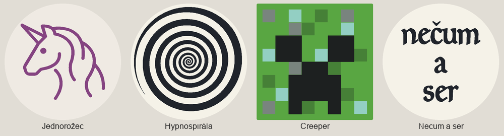

# Tisknutelný anemostat DN 125

Ventil s dutou šroubovací vsuvkou a magnetickým krytem. Hrdlo má vnější průměr 115 mm a zasouvá se 35 mm od límce. Držáky i kryt používají magnety Ø 6 × 3 mm.

- [OpenSCAD a tiskové díly](outputs/duta_vsuvka) zahrnují tělo, kryt Ø 203 mm, držáky magnetů, lepicí čepy, regulační vsuvku a klíč. Na ventil připadají čtyři držáky a osm čepů.
- [Celá vsuvka 0,15 mm](outputs/duta_vsuvka/vsuvka_015.stl) a [těsnější varianta 0,10 mm](outputs/duta_vsuvka/vsuvka_010.stl) pasují do stejného těla. Číslo udává návrhovou vůli na stranu. Pro zkoušku jsou přiložené nízké kroužky.
- [Čtyři projekty barevných talířů pro PrusaSlicer](outputs/talire_INDX) používají profil CORE One INDX 8T s tryskami 0,4 mm a vrstvou 0,20 mm. Motiv se tiskne na podložce. U dvoubarevných talířů je T1 podklad a T2 motiv. Creeper používá T1 zelenou, T2 černou, T3 šedou a T4 světle modrozelenou.

### Zdroje motivů

Podklady a generátor jsou ve [work/motivy](work/motivy). Pro opětovné vytvoření 3MF spusť v této složce `python build.py` s balíčky Pillow, NumPy, opencv-python-headless, trimesh, manifold3d, mapbox-earcut, Shapely, SciPy a resvg-py. Generátor používá lokálně instalované písmo Goudy Mediaeval DemiBold. Hotové projekty již obsahují geometrii písmen.

Dvoubarevný obrys jednorožce byl adaptován z díla Sofie Ascherl pro OpenMoji. Předloha a její úprava jsou pod licencí CC BY-SA 4.0. [OpenMoji Unicorn](https://openmoji.org/library/emoji-1F984/) · [Licence](https://creativecommons.org/licenses/by-sa/4.0/)
